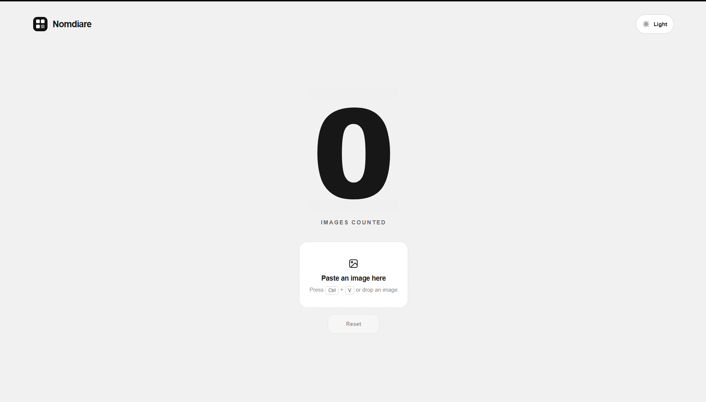

# Nomdiare — Image Counter

Nomdiare is a small, browser-based image counter. It counts images that you paste, select from your device, or drag into the page. The total is shown in a large animated counter.

## Why I built it

I came up with the idea while building **Pocketfile**. I wanted a quick way to check whether copying multiple images with the extension was behaving as expected. When I searched online for an image counter that could help with this kind of check, I could not find one that matched what I needed, so I decided to build a simple tool myself.

Nomdiare is a standalone helper for manually checking image-paste results. It is not connected to Pocketfile, does not inspect Pocketfile's code, and does not automatically test an extension. You can use it as a convenient place to paste or drop images and see how many the page detects.

## What it does

- **Paste images:** Press `Ctrl + V` while the page is open to paste images from the clipboard.
- **Select multiple images:** Click the paste area and choose one or more image files.
- **Drag and drop:** Drop one or more image files onto the paste area.
- **Animated count:** The number rolls between values with an odometer-style animation.
- **Remember the count:** The current total is saved in the browser's local storage and remains after a refresh in the same browser profile.
- **Reset:** Use the Reset button to return the counter to zero.
- **Light and dark themes:** Switch themes using the button in the top-right corner. The selected theme is remembered locally.
- **Responsive layout:** The page adapts to different screen sizes.

## How to use

1. Open `index.html` in a modern web browser, or serve the folder using any static web host.
2. Copy one or more images.
3. Return to the Nomdiare page and press `Ctrl + V` (or use the paste area to select files or drag files onto it).
4. Check the number displayed under **Images counted**.
5. Press **Reset** when you want to start a new check.

Clipboard behavior can vary depending on the browser, operating system, and the application the images are copied from. The browser must provide image data or HTML image content to the page for the paste counter to detect it.

## How counting works

- When clipboard data contains HTML image elements, Nomdiare counts the `` elements in that clipboard HTML.
- Otherwise, when the clipboard provides image files, Nomdiare creates a small visual fingerprint for each image to avoid counting alternate clipboard encodings of the same image more than once in that single paste operation. If a fingerprint cannot be created, that file is counted as a fallback.
- Images selected through the file picker or added by drag and drop are counted by the number of image files in that action.
- The counter adds each action to the existing total. It does not keep a permanent library of images or deduplicate images across separate paste, select, or drop actions.

This makes Nomdiare useful for checking the number of images detected in an action, but it should not be treated as a forensic or guaranteed duplicate-detection tool.

## Privacy and storage

Nomdiare runs in the browser. The included page does not upload images to a server and does not require an account or backend. Clipboard image processing and counting happen locally in the browser.

The count and selected theme are stored in the browser's `localStorage` under the keys `nomdiare-image-count` and `nomdiare-theme`. Resetting the counter clears the saved count by setting it to zero. Clearing the site's browser storage will also remove the saved count and theme preference.

## Project contents and technology

This package contains:

- `index.html` — the complete website, including its HTML, CSS, and JavaScript.
- `README.md` — this documentation.
- `LICENSE` — the Nomdiare proprietary source-available license supplied with the project.

The website is self-contained and uses plain HTML, CSS, and vanilla JavaScript. It does not depend on an external framework, package manager, third-party script, remote font, or external image asset.

## License

The project is accompanied by the `LICENSE` file. Please read it before using the source or an official release. In particular, public visibility of the source does not mean that the software is open source or that general copying, modification, redistribution, or commercial use is permitted.

---

Created by **Darshseraphic**.
